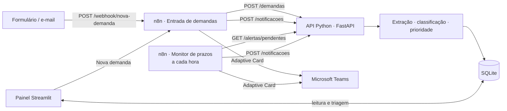

# LEGAL FLOW — Automação do fluxo de demandas jurídicas

Demandas jurídicas chegam por e-mail, formulários e outros canais, e alguém precisa ler, classificar, encaminhar,
definir prazos e acompanhar o andamento. O **LEGAL FLOW** automatiza esse caminho:

1. **Recebe** a demanda por formulário ou e-mail (webhook do n8n) ou pelo próprio painel.
2. **Extrai** solicitante, departamento, assunto, prazo e documentos (inclusive anexos de `.eml`, PDF, TXT e DOCX).
3. **Classifica** em trabalhista, cível, consumidor, contratual ou regulatória.
4. **Identifica a urgência** e sugere a prioridade (Baixa, Média, Alta, Crítica).
5. **Registra** tudo em SQLite, com histórico de cada alteração.
6. **Encaminha** ao responsável da área e o **notifica no Microsoft Teams** via n8n.
7. **Monitora os prazos** de hora em hora e envia alertas de pendências.

> Projeto de portfólio/demonstração. Use apenas dados fictícios ou anonimizados.

## Arquitetura



| Camada | Tecnologia | Onde |
|---|---|---|
| Processamento e regras | Python | `legalflow/` |
| Orquestração e integrações | n8n | `n8n/workflows/` |
| Classificação inicial | Motor de regras (modo demonstração) | `legalflow/classificacao.py` |
| Armazenamento | SQLite | `legalflow/banco.py` |
| Painel de acompanhamento | Streamlit | `painel/` |

## Como executar

### Com Docker Compose (recomendado)

```bash
cp .env.example .env          # opcional: configure o webhook do Teams
docker compose up -d --build
```

| Serviço | Endereço |
|---|---|
| Painel | http://localhost:8501 |
| API (documentação interativa) | http://localhost:8000/docs |
| n8n | http://localhost:5678 |

Na primeira execução o serviço `n8n-importar` importa e ativa os dois workflows. Ao abrir o n8n, crie a conta de
proprietário (pedida pelo próprio n8n). No painel, clique em **Carregar demandas de exemplo** na *Visão geral*.

### Sem Docker (só painel e API)

```bash
python -m venv .venv && source .venv/bin/activate
pip install -r requirements-dev.txt
python -m legalflow.seed                     # opcional: dados fictícios
uvicorn legalflow.api:app --port 8000        # API, para o n8n
streamlit run painel/app.py                  # painel
```

Sem o n8n, o painel processa as demandas localmente (sem notificação). Para testar os dois fluxos sem o n8n:

```bash
python scripts/simular_n8n.py entrada exemplos/formulario.json
python scripts/simular_n8n.py monitor
```

## Configurando o Microsoft Teams

1. No canal do Teams: **⋯ › Workflows › “Post to a channel when a webhook request is received”** e copie a URL.
2. Use a URL de uma destas formas:
   - **por responsável:** painel › *Responsáveis* › *Editar* › *Webhook do Teams*;
   - **canal padrão:** variável `TEAMS_WEBHOOK_PADRAO` no `.env` (usada para quem não tem canal próprio e para demandas sem responsável).
3. Sem nenhum canal configurado, a notificação é registrada como “sem canal” e aparece no painel.

As mensagens são Adaptive Cards com área, prioridade, prazo, solicitante, responsável e o botão **Abrir no painel**
(`LEGALFLOW_URL_PAINEL/?demanda=DEM-0001`).

## Enviando uma demanda para o webhook

`POST http://localhost:5678/webhook/nova-demanda` com JSON:

```json
{
  "canal": "Formulário",
  "solicitante": "Henrique Saldanha",
  "email_solicitante": "henrique@exemplo.com.br",
  "departamento": "Operações",
  "assunto": "Auto de infração da ANATEL",
  "descricao": "Recebemos auto de infração... Prazo para apresentar defesa até 25/11/2026.",
  "prazo": null,
  "documentos": [{ "nome": "auto.pdf", "conteudo_base64": "..." }]
}
```

Para e-mails, envie o arquivo completo: `{ "email_eml_base64": "<.eml em Base64>" }` (remetente, assunto, corpo e
anexos são lidos automaticamente). Exemplo pronto: `exemplos/formulario.json`.

```bash
curl -X POST http://localhost:5678/webhook/nova-demanda \
     -H "Content-Type: application/json" -d @exemplos/formulario.json
```

Qualquer ferramenta de formulário (Google Forms via Apps Script, Typeform, Microsoft Forms via Power Automate) ou
um nó de e-mail do n8n (IMAP/Outlook) pode enviar para esse webhook.

## Regras

**Prazo** — o informado no formulário prevalece. Senão, o sistema procura no assunto e na descrição (e, se não
achar, nos anexos): datas como `20/11/2026` ou `3 de dezembro` perto de palavras como *prazo, até, vencimento,
audiência*; ou prazos relativos como *“5 dias úteis”*, *“prazo de resposta: 10 dias”*, *“em 48 horas”*. Sem prazo,
a demanda fica marcada como **prazo a definir** e vai para a lista de pendências.

**Prioridade** — a maior entre:

| Pelo prazo (dias corridos) | Pelos termos |
|---|---|
| vencido ou ≤ 2 dias → **Crítica** | liminar, tutela de urgência, mandado, bloqueio judicial… → **Crítica** |
| 3 a 5 dias → **Alta** | audiência, citação, intimação, auto de infração… → **Alta** |
| 6 a 15 dias ou sem prazo → **Média** | notificação extrajudicial, Procon, ofício… → **Média** |
| mais de 15 dias → **Baixa** | |

**Classificação** — cada área tem termos com pesos de 1 a 3 (veja *Como funciona* no painel). A área com mais
pontos é sugerida; a confiança é a fatia da pontuação total que ela recebeu.

**Encaminhamento** — vai para o responsável ativo da área com menos demandas em aberto. A demanda fica
**Em triagem** se a área não foi identificada, se a confiança é menor que 50% ou se não há responsável na área.

**Status** — Nova → Em triagem → Encaminhada → Em andamento → Aguardando terceiros → Concluída (ou Cancelada).

**Alertas (n8n, de hora em hora)**

| Situação | Quando avisa |
|---|---|
| Prazo vencido | a cada 24 h enquanto a demanda estiver aberta |
| Vence hoje | uma vez |
| Vence em breve (≤ 3 dias) | uma vez (de novo se o prazo for alterado) |
| Prazo a definir | uma vez, 24 h após o recebimento |

Os intervalos são configuráveis no `.env`.

## Painel

| Página | Para quê |
|---|---|
| Visão geral | indicadores, demandas por área e prioridade, atenção imediata |
| Nova demanda | registro por formulário ou `.eml`, com documentos |
| Demandas e triagem | filtros, detalhe, documentos, correção da classificação, histórico e notificações |
| Prazos e alertas | vencidas, vencendo, sem prazo e os alertas que o n8n enviará na próxima execução |
| Responsáveis | cadastro da equipe por área e do webhook do Teams |
| Como funciona | etapas e regras |

## Estrutura

```
legalflow/            núcleo em Python
  extracao.py         leitura de e-mail e documentos, prazo, solicitante
  classificacao.py    motor de regras por área
  prioridade.py       urgência e prioridade
  servico.py          registro, encaminhamento, triagem, alertas, cartões do Teams
  banco.py            SQLite
  api.py              API para o n8n
  seed.py             dados fictícios
painel/               Streamlit (app.py, estilo.py, componentes.py, paginas/)
n8n/workflows/        01_entrada_demandas.json, 02_monitor_prazos.json
scripts/              gerador dos workflows e simulador do n8n
exemplos/             e-mail, formulário e documento fictícios
tests/                pytest
```

## Testes

```bash
pip install -r requirements-dev.txt
pytest
```

## Limitações conhecidas

- Classificação apenas por regras (modo demonstração); não há chamada a modelos de IA generativa.
- Dias úteis não consideram feriados.
- Imagens são armazenadas, mas sem OCR.
- Sem autenticação no painel e na API — não exponha à internet sem um proxy com login.
